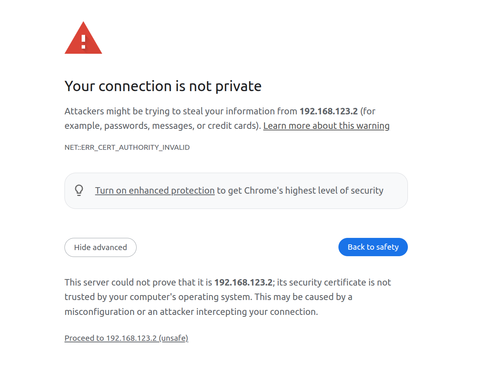
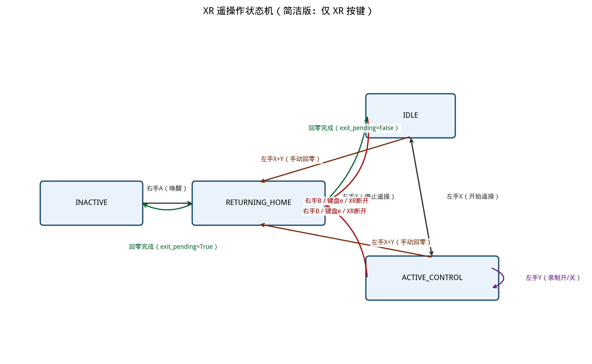

# DUCOROBOTS RICO XR 遥操作系统

[中文](README_zh.md) | [English](README.md)

本仓库实现了面向 DUCOROBOTS RICO 双臂机器人的集成式 XR 遥操作系统，支持 Ubuntu 22.04（ARM64 / X86）部署。当前代码聚焦于仓库内已接线打通的部分：


| 组件               | 状态  | 说明                                       |
| ---------------- | --- | ---------------------------------------- |
| RICO 双臂遥操作       | 完成  | `teleop/teleop_hand_and_arm.py` 驱动顶层状态机  |
| 腰部 / 外部轴控制       | 完成  | 可通过 `--no-waist` 禁用（默认开启）                |
| 头部 / 外部轴控制       | 完成  | 可通过 `--no-head` 禁用（默认开启）                 |
| BChand 灵巧手控制     | 完成  | 基于扳机 / pinch 阈值的开合逻辑                     |
| TeleImager 多相机服务 | 完成  | 支持头部、腕部、胸部相机，ZMQ/WebRTC 多协议,胸部相机仅本地可支持使用 |
| TeleVuer XR 桥接   | 完成  | 在 `8012` 端口提供 HTTPS / WSS XR 页面          |
| Episode 录制       | 完成  | 将颜色图、深度图、状态和动作保存到任务目录                    |
| FastAPI 数据管理接口   | 完成  | RESTful API 管理任务、录制导入导出                  |
| 进程内仿真占位模式        | 完成  | 由 `--sim` 启用，复用 XR / 录制流程,适用于无硬件环境调试等    |


一次典型部署中的角色如下：

- `Host`：运行 `python3 teleop/teleop_hand_and_arm.py`，提供 TeleVuer 与 FastAPI。
- `Vision Server`：运行 `humanoid_vision_system_ws`，连接多路相机并发布流。
- `XR Headset`：从 Host 打开 TeleVuer 页面，并按需在首次连接时信任 image server 证书。
- `RICO Robot`：接收来自 Host 的双臂、腰部，头部和灵巧手控制指令。

信号链：

1. `HumanoidVisionSystem` 发布头部、腕部、胸部彩色图与深度图流。
2. `ImageClient` 通过 ZMQ 读取这些流。
3. `TeleVuer` 在 `https://<host-ip>:8012/?ws=wss://<host-ip>:8012` 提供 XR 页面。
4. `TeleVuerWrapper` 将 XR 位姿和按钮转换为机器人控制目标。
5. `EpisodeWriter` 将图像帧和机器人状态保存到 `data/task_xxxx/episode_xxxx/`。
6. `FastAPI` 提供任务管理、录制导入导出 REST 接口。

## 目录

- [DUCOROBOTS RICO XR 遥操作系统](#ducorobots-rico-xr-遥操作系统)
  - [目录](#目录)
- [1. 系统要求](#1-系统要求)
- [2. 安装](#2-安装)
  - [2.1 基础安装](#21-基础安装)
  - [2.2 TeleImager 视觉服务端](#22-teleimager-视觉服务端)
  - [2.3 TeleVuer 与证书](#23-televuer-与证书)
  - [2.4 环境变量与防火墙](#24-环境变量与防火墙)
- [3. 快速启动](#3-快速启动)
  - [3.1 启动视觉服务端](#31-启动视觉服务端)
  - [3.2 遥操作启动参数说明](#32-遥操作启动参数说明)
  - [3.3 在 Host 启动遥操作](#33-在-host-启动遥操作)
  - [3.4 操作说明](#34-操作说明)
    - [FastAPI 控制](#fastapi-控制)
  - [3.5 状态机转移图](#35-状态机转移图)
  - [3.6 休眠](#36-休眠)
- [4. 配置说明](#4-配置说明)
  - [4.1 xr\_teleoperate\_rico/config/system.json](#41-xr_teleoperate_ricoconfigsystemjson)
    - [4.1.1 network 网络配置](#411-network-网络配置)
    - [4.1.2 runtime 运行时配置](#412-runtime-运行时配置)
    - [4.1.3 XR/VR 配置](#413-xrvr-配置)
    - [4.1.4 paths 路径配置](#414-paths-路径配置)
    - [4.1.5 log\_manager 日志配置](#415-log_manager-日志配置)
    - [4.1.6 recording 录制配置](#416-recording-录制配置)
    - [4.1.7 recording.text 任务文本信息](#417-recordingtext-任务文本信息)
    - [4.1.8 recording.info 数据集元信息](#418-recordinginfo-数据集元信息)
  - [4.2 xr\_teleoperate\_rico/config/robot.json](#42-xr_teleoperate_ricoconfigrobotjson)
    - [4.2.1 robot 机器人本体配置](#421-robot-机器人本体配置)
    - [4.2.2 robot.home\_arm\_joint\_deg/robot.home\_arm\_joint\_deg\_p 回零关节角度（度）](#422-robothome_arm_joint_degrobothome_arm_joint_deg_p-回零关节角度度)
    - [4.2.3 robot.home\_head\_rad 头部回零目标（弧度）](#423-robothome_head_rad-头部回零目标弧度)
    - [4.2.4 robot.home\_half\_waist\_rad/robot.home\_full\_waist\_rad 腰部回零目标（弧度）](#424-robothome_half_waist_radrobothome_full_waist_rad-腰部回零目标弧度)
    - [4.2.5 robot.servo 伺服控制参数](#425-robotservo-伺服控制参数)
    - [4.2.6 end\_effector 末端执行器（灵巧手）配置](#426-end_effector-末端执行器灵巧手配置)
  - [4.3 manual\_camera.json 视觉配置](#43-manual_camerajson-视觉配置)
    - [4.3.1 顶层字段](#431-顶层字段)
    - [4.3.2 global 全局配置](#432-global-全局配置)
    - [4.3.3 通用相机字段](#433-通用相机字段)
    - [4.3.4 streams 视频流配置](#434-streams-视频流配置)
    - [4.3.5 compression 压缩配置](#435-compression-压缩配置)
    - [4.3.6 publisher\_compression 发布器级压缩覆盖](#436-publisher_compression-发布器级压缩覆盖)
    - [4.3.7 communication 通信配置](#437-communication-通信配置)
      - [ZeroMQ 配置](#zeromq-配置)
      - [WebSocket 配置](#websocket-配置)
      - [WebRTC 配置](#webrtc-配置)
      - [ROS2 配置](#ros2-配置)
    - [4.3.8 各相机通信端口速查](#438-各相机通信端口速查)
    - [4.3.9 完整配置示例](#439-完整配置示例)
  - [4.4 global\_config.json 视觉配置](#44-global_configjson-视觉配置)
- [5. API 接口](#5-api-接口)
- [6. 代码结构](#6-代码结构)
- [7. 鸣谢](#7-鸣谢)

---

# 1. 系统要求

- Ubuntu 22.04 LTS（ARM64 或 X86）
- ROS2 Humble
- Python 3.10+
- RealSense 相机（支持 D435 / D405 等）
- ARM64 架构和 X86 架构均可运行，依赖已针对双架构适配，可根据实际环境替换对应指令
- 最简单的集成方案是为 Host 侧工具共用一个 Python `3.10` conda 环境

---

# 2. 安装

## 2.1 基础安装

> **注意：** 
> 保证顶层目录为 xr_teleoperate_rico 即`teleop/`上层目录为`/path/to/xr_teleoperate_rico`, 下述命令及代码均基于此目录运行

```bash
# 安装 Miniconda3

mkdir -p ~/miniconda3
#下载命令 ARM64 架构和 X86 架构二选一
wget https://repo.anaconda.com/miniconda/Miniconda3-latest-Linux-aarch64.sh -O ~/miniconda3/miniconda.sh #ARM64
# wget https://repo.anaconda.com/miniconda/Miniconda3-latest-Linux-x86_64.sh -O ~/miniconda3/miniconda.sh #X86_64
bash ~/miniconda3/miniconda.sh -b -u -p ~/miniconda3
rm ~/miniconda3/miniconda.sh
source ~/miniconda3/bin/activate
conda init --all
conda tos accept --override-channels --channel https://repo.anaconda.com/pkgs/main
conda tos accept --override-channels --channel https://repo.anaconda.com/pkgs/r

# 配置清华镜像源，架构通用
conda config --add channels https://mirrors.tuna.tsinghua.edu.cn/anaconda/cloud/conda-forge/
conda config --add channels https://mirrors.tuna.tsinghua.edu.cn/anaconda/pkgs/free/
conda config --add channels https://mirrors.tuna.tsinghua.edu.cn/anaconda/pkgs/main/
conda config --set show_channel_urls yes
```

```bash
# 创建并激活 Python 3.10 环境
conda create -n rico_xr python=3.10 numpy=1.26.4 -y
conda activate rico_xr

# 进入仓库根目录
cd /path/to/xr_teleoperate_rico

# 安装依赖,conda环境下运行
pip install -r requirements.txt -i https://pypi.tuna.tsinghua.edu.cn/simple
```

## 2.2 TeleImager 视觉服务端

视觉服务端运行在独立机器或同一机器上，通过 ROS2 或 FastAPI驱动多路相机。

```bash
# 非conda环境下运行
cd /path/to/xr_teleoperate_rico

# 添加ros2源
# 导入 ROS 2 GPG 公钥
sudo apt install curl -y
sudo curl -sSL https://raw.githubusercontent.com/ros/rosdistro/master/ros.key | sudo gpg --dearmor -o /usr/share/keyrings/ros-archive-keyring.gpg
# 添加清华 ROS 2 镜像源
echo "deb [arch=$(dpkg --print-architecture) signed-by=/usr/share/keyrings/ros-archive-keyring.gpg] https://mirrors.tuna.tsinghua.edu.cn/ros2/ubuntu jammy main" | sudo tee /etc/apt/sources.list.d/ros2.list

# 安装 ROS2 依赖
sudo apt update
sudo apt install ros-humble-desktop \
    ros-humble-sensor-msgs \
    ros-humble-vision-msgs \
    ros-humble-tf2-ros \
    ros-humble-image-transport \
    v4l-utils \
    python3-colcon-common-extensions \
    protobuf-compiler

# 编译 Protocol Buffers
cd teleop/teleimager/humanoid_vision_system_ws/src/humanoid_vision_system
bash scripts/compile_proto.sh

# 构建 ROS2 工作空间
cd ../../ #回到teleop/teleimager/humanoid_vision_system_ws/目录
source /opt/ros/humble/setup.bash
rm -rf build/ install/ log/ #确保目录正确清理旧缓存
colcon build --packages-select humanoid_vision_system
source install/setup.bash

cd ../ #回到teleop/teleimager/目录
cp -r humanoid_vision_system_ws/src/humanoid_vision_system/vision_system/proto src/teleimager/
# 注意：保证视觉服务端和视觉客户端的proto文件一致
```

## 2.3 TeleVuer 与证书

证书查找顺序：

1. `XR_TELEOP_CERT` 和 `XR_TELEOP_KEY` 环境变量
2. `~/.config/xr_teleoperate/cert.pem` 和 `key.pem`
3. 内置的 `xr_teleoperate_rico/teleop/televuer/ 目录下的` `cert.pem` 和 `key.pem`（仅适合本地测试需替换为你生成的证书）

生成自签名证书：

```bash
安装 mkcert并生成证书
# 例如在download文件夹下执行,生成证书，ARM64 架构和 X86 架构二选一
mkdir -p humanoid_vision_system_ws/download
cd humanoid_vision_system_ws/download
sudo apt install libnss3-tools
# arm64架构
curl -JLO "https://dl.filippo.io/mkcert/latest?for=linux/arm64"
chmod +x mkcert-v*-linux-arm64 #替换为你下载的文件名
sudo mv mkcert-v*-linux-arm64 /usr/local/bin/mkcert
# X86 架构证书安装
# curl -JLO "https://dl.filippo.io/mkcert/latest?for=linux/amd64"
# chmod +x mkcert-v*-linux-amd64
# sudo mv mkcert-v*-linux-amd64 /usr/local/bin/mkcert

# 生成并安装本地 CA 证书
mkcert -install

# 生成针对本机 IP 和 localhost 的证书
# 注意：请将 192.168.120.44 替换为您的实际IP地址
mkcert 192.168.120.44 localhost

# 替换证书（注意：mkcert生成的证书文件名格式为：<IP>+<数字>.pem）
# 例如：192.168.120.44+1.pem，请根据实际生成的文件名调整复制命令
mkdir -p ~/.config/xr_teleoperate
cp 192.168.120.44+1.pem ~/.config/xr_teleoperate/cert.pem
cp 192.168.120.44+1-key.pem ~/.config/xr_teleoperate/key.pem

# xr_teleoperate_rico/teleop/televuer/ 目录下的 `cert.pem` 和 `key.pem` 自行替换,eg:
cp 192.168.120.44+1.pem ../../../televuer/cert.pem
cp 192.168.120.44+1-key.pem ../../../televuer/key.pem
```

## 2.4 环境变量与防火墙

```bash
# 证书环境变量
echo 'export XR_TELEOP_CERT="$HOME/.config/xr_teleoperate/cert.pem"' >> ~/.bashrc
echo 'export XR_TELEOP_KEY="$HOME/.config/xr_teleoperate/key.pem"' >> ~/.bashrc
source ~/.bashrc

# 防火墙放行端口
sudo apt install ufw
sudo ufw allow 8012   # TeleVuer HTTPS/WSS
sudo ufw allow 8000   # FastAPI
sudo ufw allow 60000  # 视觉服务端配置请求
sudo ufw allow 5555   # ZMQ 图像流,多端口需都放开
```

---

# 3. 快速启动

## 3.1 启动视觉服务端

在视觉服务端机器（或同一机器）上：

```bash
# 确保已编译完成视觉服务端代码
cd teleop/teleimager/humanoid_vision_system_ws

conda activate rico_xr
source /opt/ros/humble/setup.bash
source install/setup.bash

# 启动（自动检测并启动头部相机（默认））
ros2 run humanoid_vision_system vision_system_main.py --auto-detect

# 或使用手动配置(需要先配置xr_teleoperate_rico/teleop/teleimager/humanoid_vision_system_ws/manual_config/manual_camera.json)
ros2 run humanoid_vision_system vision_system_main.py --no-auto-detect
```

结合本仓库当前实现，需要特别注意：

- `[xr_teleoperate_rico/teleop/teleimager/humanoid_vision_system_ws/manual_config/manual_camera.json]` 是主集成相机配置，请查看4.3节。
- `humanoid_vision_system_ws` 在 --no-auto-detect 启动时不会开启 discovery，因此需要先设置相机配置，注意：
  - `type: realsense` 并提供 `serial_number`
  - `type: opencv` 并提供 `video_id`
- 如果humanoid_vision_system_ws 无法响应，humanoid_image_client 会按默认配置回退

关于显示路径，有一个很重要的注意事项：

- 应将 `head_camera.enable_webrtc: true` 和本地 `immersive` / `ego` 推图视为互斥部署选择。
- 当 `head_camera.enable_webrtc: true` 时，头显中的头部视图来自humanoid_vision_system_ws 的 WebRTC 端点。
- 当 `head_camera.enable_webrtc: false` 时，`teleop_hand_and_arm.py` 会先通过 ZMQ 读取头图，再由 `TeleVuer` 以 `immersive` / `ego` 方式自行推送。
- 不要把这两条路径当作同一会话里并行存在的两套头部显示链路来配置。

仿真备注：

- `--sim` 是流程占位模式，不是完整模拟器后端。
- 它会复用同样的 XR 页面、录制器和可选图像服务链路，只是把机器人 / 腰部 / 手部 / BChand 的硬件访问替换成进程内占位后端。
- 如果你只是练习 XR 控制流程，可以把 `xr.display_mode` 设成 `pass-through`，这样就可以完全跳过图像服务。
- 如果你希望仿真流程也覆盖图像链路，则按本节完全相同的方式启动humanoid_vision_system_ws ，然后让 Host 指向该服务。
- 如果无图像服务端或者图像服务端启动失败没有相机配置，遥操主程序会以无图像模式运行，不影响机器人遥操作，数据录制将只记录机器人数据。

## 3.2 遥操作启动参数说明

顶层 CLI 定义在 `[xr_teleoperate_rico/teleop/teleop_hand_and_arm.py](./teleop/teleop_hand_and_arm.py)`。


| 参数                  | 说明                                    | 可选值     | 默认值                                |
| ------------------- | ------------------------------------- | ------- | ---------------------------------- |
| `--config-dir`      | 包含 `system.json0` 和`robot.json` 的配置目录 | 任意有效路径  | `./config`                         |
| `--task-dir`        | 录制输出目录                                | 任意有效路径  | `system.paths.task_dir`            |
| `--headless`        | 关闭本地 OpenCV 预览窗口                      | flag    | 关闭                                 |
| `--full-body`       | 全身人形整机,影响腰部控制                                | flag    | 关闭                                 |
| `--sim`             | 用进程内占位后端替代双臂 / 腰部 / 手部硬件控制            | flag    | 关闭                                 |
| `--no-waist`        | 禁用腰部 / 外部轴控制                          | flag    | 跟随 `runtime.waist_enabled_default` |
| `--no-head`         | 禁用头部 / 外部轴控制                          | flag    | 跟随 `runtime.head_enabled_default`  |
| `--image-server-ip` | 覆盖 TeleImager 的 Host 地址               | IPv4    | `system.network.image_server_ip`   |
| `--frequency`       | 覆盖主循环频率和录制 FPS                        | 任意合理浮点数 | `system.runtime.frequency`         |
| `--no-image-server` | 是否禁用图像服务端                            | flag    | 跟随 `runtime.enable_image_server`  |


当前 RICO 主入口并没有 XR 模式相关 CLI 参数。这两个值由 `[config/system.json](./config/system.json)` 中的配置驱动：


| 配置键               | 说明              | 可选值                              | 默认值          |
| ----------------- | --------------- | -------------------------------- | ------------ |
| `xr.input_mode`   | 选择 XR 输入解释方式    | `controller`、`hand`              | `controller` |
| `xr.display_mode` | 选择头显中的机器人视图显示方式 | `immersive`、`ego`、`pass-through` | `immersive`  |

>**注意：** hand控制仅为占位模式,当前仅支持手柄控制。

几个容易混淆的行为说明：

- `--sim`、`--image-server-ip`、`--frequency`、`--enable-image-server`、`--task-dir`、`--full-body`、`--no-waist` 和 `--no-head` 都会在运行时覆盖 JSON 配置。
- `paths.task_dir` 是相对于根目录 `xr_teleoperate_rico` 解析的,保持默认即可。
- `--no-image-server` 即禁用图像服务端，遥操主程序会以无图像模式运行，不影响机器人遥操作，数据录制将只记录机器人数据。

## 3.3 在 Host 启动遥操作

```bash
#启动遥操作
cd /path/to/xr_teleoperate_rico

conda activate rico_xr

python3 teleop/teleop_hand_and_arm.py
```

在 XR 设备浏览器中打开：

```
https://<host-ip>:8012/?ws=wss://<host-ip>:8012
```

其中：

- `<host-ip>` 是运行 `teleop_hand_and_arm.py` 的那台机器
- `<server-ip>` 是运行 `图项服务端` 的那台机器
- 如果XR头显浏览器无法打开或网络问题，请确保XR头显和遥操端主机在同一局域网内后，重启浏览器后重试
- 如果是单机部署，两者可以相同

一些常用的 Host 侧启动变体：

- 禁用腰部 / 外部轴：配置项 `config/system.json` 中的 `runtime.waist_enabled_default` 为 `true`的前提下启动则默认开启腰部控制，添加 `--no-waist`，则禁用腰部控制
- 禁用头部 / 外部轴：配置项 `config/system.json` 中的 `runtime.head_enabled_default` 为 `true`的前提下启动则默认开启头部控制，添加 `--no-head`，则禁用头部控制
- 禁用图像服务端：配置项 `config/system.json` 中的 `runtime.enable_image_server` 为 `true`的前提下启动则默认开启图像服务端，添加 `--no-image-server`，则禁用图像服务端，遥操主程序会以无图像模式运行，不影响机器人遥操作，数据录制将只记录机器人数据,此时应修改`config/system.json`中`xr.display_mode`为`pass-through`
- 关闭本地 OpenCV 预览窗口：添加 `--headless`
- 全身人形整机,影响腰部控制：添加 `--full-body`，则开启全身人形整机控制，全身整机腰部4关节，半身整机腰部1关节。
- 不改 Json 而直接切换 image server：添加 `--image-server-ip <server-ip>`

仿真备注：如果你想用相同流程演练而不接触真实硬件，只需在 Host 命令里加上 `--sim`：

```bash
python3 teleop/teleop_hand_and_arm.py \
  --sim \
  --image-server-ip <server-ip>
```

如果你在 `--sim` 模式下同时把 `xr.display_mode` 设成 `pass-through`，并且完全不启用图像服务，那么 `--image-server-ip` 可以省略。

对于实物部署和 `--sim`，头显侧的推荐启动顺序相同：

1. 确保 XR 头显和 Host 在同一局域网。
2. 如果 `head_camera.enable_webrtc: true`，先在头显浏览器中打开 `https://<server-ip>:<head_camera.webrtc_port>/`，按提示信任证书，并点击 `Start`，确认图像服务工作正常。

<p align="center">
  
</p>

3. 打开 Host 侧 XR 页面：

```text
https://<host-ip>:8012/?ws=wss://<host-ip>:8012
```

4. 如果浏览器弹出证书警告，请先信任 Host 证书。

<p align="center">
  
</p>

5. 在 `TeleVuer` 页面中点击 `Virtual Reality`，并允许浏览器弹出的所有 XR 相关权限请求。

6. 当 XR 会话建立完成后，你应当能在头显中看到机器人第一视角，同时终端也会打印类似下面的连接日志：

```bash
websocket is connected. id:dbb8537d-a58c-4c57-b49d-cbb91bd25b90
default socket worker is up, adding clientEvents
Uplink task running. id:dbb8537d-a58c-4c57-b49d-cbb91bd25b90
```

7. 在开始遥操作前，请先将双臂对齐到机器人的初始姿态，以避免开始控制时出现突跳。

<p align="center">
  
</p>


## 3.4 操作说明

| 操作     | 设备    | 生效状态                         | 功能                                                            |
| ------ | ----- | ---------------------------- | ------------------------------------------------------------- |
| 右手 A   | XR 手柄 | 仅 INACTIVE                   | 唤醒并回零，回零完成后进入 IDLE                                            |
| 右手 B   | XR 手柄 | IDLE / ACTIVE_CONTROL        | 退出遥操作，先进入 RETURNING_HOME 回零，回零完成后进入 INACTIVE             |
| 左手 X   | XR 手柄 | IDLE（启动）/ ACTIVE_CONTROL（停止） | 开始遥操作（进入 ACTIVE_CONTROL）；停止遥操作（回到 IDLE，同时自动停止录制并保存）           |
| 左手 Y   | XR 手柄 | 仅 ACTIVE_CONTROL             | 开启/关闭录制（切换 toggle）                                            |
| 左手 X+Y | XR 手柄 | IDLE / ACTIVE_CONTROL        | 手动回零，进入 RETURNING_HOME，回零完成后进入 IDLE；若正在录制则回零过程也会被录制，回零完成后自动保存 |
| 左手 扳机键 | XR 手柄 | 仅 ACTIVE_CONTROL             | 根据扳机键状态切换，按下=握持，松开=松开 (需灵巧手)                                  |
| 右手 扳机键 | XR 手柄 | 仅 ACTIVE_CONTROL             | 根据扳机键状态切换，按下=握持，松开=松开 (需灵巧手)                                  |
| 蹲下/站起  | XR头显&手柄 | 仅 ACTIVE_CONTROL             | 身体升降(仅针对全身整机，需开启腰部控制)                               |
| 前后移动  | XR头显&手柄 | 仅 ACTIVE_CONTROL             | 身体前倾/后坐移动(仅针对全身整机，需开启腰部控制,不建议此操作)              |
| 俯仰  | XR头显&手柄 | 仅 ACTIVE_CONTROL             | 身体俯仰(仅针对全身整机，需开启腰部控制)                                    |
| 扭腰  | XR头显&手柄 | 仅 ACTIVE_CONTROL             | 腰部旋转                                                               |
| 移动双臂   | XR 手柄 | 仅 ACTIVE_CONTROL             | 头部运动(需开启头部控制)                                                |
| 键盘 e   | 键盘    | 任意非 INACTIVE 态               | 紧急停止，先进入 RETURNING_HOME 回零，回零完成后进入 INACTIVE             |


> 注意：
> 尽量不要进行前后移动操作，保持人体位置固定进行操作
> 头部和腰部控制详细看 [3.3 节](README_zh.md#33-在-Host-启动遥操作) 和 [4.1.2 节](README_zh.md#412-runtime-运行时配置)，默认开启腰部控制,头部控制

### FastAPI 控制

可通过 REST API 控制录制和任务管理：

```bash
# 前端页面控制，注意FastAPI控制和XR控制互斥
```

## 3.5 状态机转移图

系统包含 4 个主状态。所有需要退出/停止的转移都必须先经过 `RETURNING_HOME` 完成回零，再根据 `exit_pending` 标志决定最终落脚状态：

- `exit_pending = True` → 回零完成后进入 `INACTIVE`（完全退出）
- `exit_pending = False` → 回零完成后进入 `IDLE`（仅回零，不退出）

```
                           ┌──────────────────────────────────────────┐
                           │              右手 B / XR断开 / 键盘 e      │
                           │  (exit_pending=True → 回零后到 INACTIVE)  │
                           ▼                                          │
INACTIVE ──[右手 A]──> RETURNING_HOME ──[exit_pending=False]──> IDLE   │
   ▲                                    ▲                      │  │   │
   │                                    │                      │  │   │
   │                    左手 X+Y / API   │ GO_HOME              │  │   │
   │                    (exit_pending   │ =False)              │  │   │
   │                                    │                      │  │   │
   │              ┌─────────────────────┘                      │  │   │
   │              │                                            ▼  │   │
   │              │                           ACTIVE_CONTROL ─────┘   │
   │              │                                │  │               │
   │              │              ┌─────────────────┘  │               │
   │              │              │                    │               │
   │              │     [左手 X]  │         [左手 Y]   │               │
   │              │     停止遥操  │          录制开/关  │                │
   │              │     停止录制  │                    │               │
   │              │              ▼                    ▼               │
   │              │            IDLE              ACTIVE_CONTROL       │
   │              │            (状态不变)                              │
   │              │                                                   │
   └──────────────┘  RETURNING_HOME ──[exit_pending=True]── 回零完成 ──┘
```
<p align="center">
  
</p>

<a id="physical-deployment"></a>


**状态说明：**


| 状态               | 说明                                                                                                            |
| ---------------- | ------------------------------------------------------------------------------------------------------------- |
| `INACTIVE`       | 系统休眠，等待唤醒。只能响应右手 A 或 API `INIT_RESET` 唤醒。                                                                     |
| `IDLE`           | 待机态，可接受控制请求。等待左手 X 进入主动控制（需获取控制锁），可响应左手 X+Y 手动回零，可响应右手 B 退出。                                                  |
| `ACTIVE_CONTROL` | 主动遥操作态。XR 手柄或 API 控制机器人，录制（可选）进行中。可响应左手 X 停止遥操、左手 Y 切换录制、左手 X+Y 手动回零、右手 B 退出。                                 |
| `RETURNING_HOME` | 回零中。双臂和（若启用）腰部自动回到 home 位姿。回零过程中若正在录制则继续录制。回零完成后根据 `exit_pending` 决定进入 `INACTIVE` 或 `IDLE`，录制中的 episode 自动保存。 |


**录制与回零的交互逻辑：**

```
IDLE（未录制）
  左手 X
    -> 获取 XR 控制权 → 进入 ACTIVE_CONTROL

  左手 X+Y
    -> 进入 RETURNING_HOME（exit_pending=False）
    -> 回零完成后进入 IDLE（未录制，不保存）

  右手 B / 键盘 e
    -> 进入 RETURNING_HOME（exit_pending=True）
    -> 回零完成后进入 INACTIVE

ACTIVE_CONTROL
  左手 X（停止遥操作）
    -> 释放控制权
    -> 若正在录制 → 保存当前 episode → 停止录制
    -> 回到 IDLE

  左手 Y（切换录制状态）
    -> 未录制时 → 创建新 episode → 开始录制
    -> 录制中时 → 保存当前 episode → 停止录制
    -> 遥操状态保持 ACTIVE_CONTROL 不变

  左手 X+Y（手动回零）
    -> 释放控制权
    -> 进入 RETURNING_HOME（exit_pending=False）
    -> 若正在录制 → 回零过程继续录制
    -> 回零完成后 → 自动保存 episode（若在录制）→ 进入 IDLE

  右手 B（退出遥操作）
    -> 释放控制权
    -> 进入 RETURNING_HOME（exit_pending=True）
    -> 若正在录制 → 回零过程继续录制
    -> 回零完成后 → 自动保存 episode → 进入 INACTIVE

  键盘 e（紧急停止）
    -> 立即释放控制权 + 强制停止双臂
    -> 进入 RETURNING_HOME（exit_pending=True）
    -> 回零完成后进入 INACTIVE
```

> 每次暂停遥操作之后，若想再进入遥操作，尽量保持退出前人体姿态避免突变或直接回零后再操作

**API 命令对状态的影响：**


| API 命令           | 触发条件                        | 行为与状态跳转                                                                    |
| ---------------- | --------------------------- | -------------------------------------------------------------------------- |
| `EMERGENCY_STOP` | 任意态（非 INACTIVE）             | 释放控制权 + 停止双臂 → RETURNING_HOME（`exit_pending=True`），回零后 → INACTIVE          |
| `INIT_RESET`     | 仅 INACTIVE 态                | → RETURNING_HOME（`exit_pending=False`），回零后 → IDLE                          |
| `GO_HOME`        | 非 INACTIVE / RETURNING_HOME | 若在 ACTIVE_CONTROL 则释放控制权 → RETURNING_HOME（`exit_pending=False`），回零后 → IDLE |
| `START_TELEOP`   | IDLE + 控制锁空闲                | 获取 API 控制权 → ACTIVE_CONTROL                                                |
| `STOP_TELEOP`    | ACTIVE_CONTROL + API 持有控制   | 释放控制权；若正在录制则保存 episode 并停止录制 → IDLE                                        |
| `START_RECORD`   | ACTIVE_CONTROL + 未录制        | 创建新 episode → 开启录制                                                         |
| `STOP_RECORD`    | 录制中                         | 保存当前 episode → 停止录制                                                        |


**XR 网页断开处理：**

- 检测到 XR 网页断开（下降沿）时，如果当前不在 `INACTIVE` 或 `RETURNING_HOME`：
  - 释放控制权（若在 ACTIVE_CONTROL）
  - 进入 `RETURNING_HOME`（`exit_pending = True`）
  - 回零完成后进入 `INACTIVE`

## 3.6 休眠

"休眠"（即进入 `INACTIVE` 状态）由以下任一操作触发：右手 B、键盘 e、XR 网页断开、API `EMERGENCY_STOP`。

进入休眠时程序的完整流程：

1. **状态转换**：当前状态（`IDLE` 或 `ACTIVE_CONTROL`）→ 进入 `RETURNING_HOME`（`exit_pending = True`）
2. **释放控制权**：若在 `ACTIVE_CONTROL` 中，自动释放控制锁
3. **机械回零**：双臂和（若启用）腰部自动回到 home 位姿
4. **继续录制**：若回零前正在录制，回零过程中的每一帧数据仍会被记录到当前 episode
5. **保存 episode**：回零完成后，若正在录制则自动保存该 episode 并停止录制
6. **最终状态**：进入 `INACTIVE`，等待下次唤醒（右手 A 或 API `INIT_RESET`）

---

# 4. 配置说明

## 4.1 xr_teleoperate_rico/config/system.json

### 4.1.1 network 网络配置


| 键                            | 说明                                                                 | 类型 / 可选值 / 默认值                     |
| ---------------------------- | ------------------------------------------------------------------ | ---------------------------------- |
| `network.image_server_ip`    | 视觉服务端 IP，`ImageClient` 使用的服务地址，同时也用于传给 `TeleVuer` 的默认 `webrtc_url` | IPv4 / hostname / `192.168.120.44` |
| `network.image_request_port` | 相机配置请求端口，固定 60000 用于获取视觉服务端相机配置                                    | integer / `60000`                  |
| `network.fastapi_host`       | FastAPI 监听地址                                                       | string / `0.0.0.0`                 |
| `network.fastapi_port`       | FastAPI 端口                                                         | integer / `8000`                   |


### 4.1.2 runtime 运行时配置


| 键                               | 说明                                  | 类型 / 可选值 / 默认值    |
| ------------------------------- | ----------------------------------- | ----------------- |
| `runtime.frequency`             | 主循环频率，同时也会作为录制器写入 episode 头信息中的 FPS | float / `60.0`    |
| `runtime.headless`              | 是否关闭本地图像预览窗口                        | boolean / `false` |
| `runtime.sim_enabled_default`   | 在没有 CLI 覆盖前，决定默认是否启用进程内仿真占位模式       | boolean / `false` |
| `runtime.waist_enabled_default` | 决定默认是否初始化(启用)腰部 / 外部轴控制器            | boolean / `true` |
| `runtime.head_enabled_default` | 决定默认是否初始化(启用)头部 / 外部轴控制器 | boolean / `true` |
| `runtime.enable_image_server` | 是否启用图像服务端                            | boolean / `true` |

> 不启用图像服务端或者图像服务端启用失败，遥操主程序会以无图像模式运行，不影响机器人遥操作，数据录制将只记录机器人数据。

### 4.1.3 XR/VR 配置


| 键                 | 说明                                                                       | 类型 / 可选值 / 默认值                                 |
| ----------------- | ------------------------------------------------------------------------ | ---------------------------------------------- |
| `xr.input_mode`   | XR 输入模式：`controller`=手柄控制（扳机→灵巧手，头部偏移→腰部）；`hand`=手部跟踪（捏合→灵巧手，无腰部控制，当前仅为占位实现）      | `controller`、`hand` / `controller`             |
| `xr.display_mode` | XR 显示模式：`immersive`=全屏沉浸显示机器人视角；`pass-through`=透视模式不叠加图像；`ego`=中央小窗+周围透视 | `immersive`、`ego`、`pass-through` / `immersive` |

>腰部详细控制请看[4.2.4-4.2.5 节](#424-robothome_half_waist_radrobothome_full_waist_rad-腰部回零目标弧度)


### 4.1.4 paths 路径配置


| 键                 | 说明        | 类型 / 可选值 / 默认值         |
| ----------------- | --------- | ---------------------- |
| `paths.task_dir`  | 任务数据根目录   | string / `data`        |
| `paths.trash_dir` | 任务数据回收站目录 | string / `data/.trash` |


### 4.1.5 log_manager 日志配置


| 键                 | 说明 | 类型 / 可选值 / 默认值         |
| ----------------- | --------- | ---------------------- |
| `log_manager.log_dir` | 日志目录 | string / `logs` |
| `log_manager.level` | 日志级别 | string / `INFO` |
| `log_manager.console` | 是否在控制台输出日志 | boolean / `true` |
| `log_manager.rotation_size_mb` | 日志文件最大大小（MB） | integer / `120` |
| `log_manager.retention_days` | 日志文件保留天数 | integer / `60` |
| `log_manager.compression_enabled` | 是否启用日志文件压缩 | boolean / `true` |
| `log_manager.encoding` | 日志文件编码 | string / `utf-8` |


### 4.1.6 recording 录制配置


| 键                             | 说明                   | 类型 / 可选值 / 默认值    |
| ----------------------------- | -------------------- | ----------------- |
| `recording.rerun_log`         | 是否启用 Rerun可视化        | boolean / `false` |
| `recording.save_audio`        | 是否保存音频数据             | boolean / `false` |
| `recording.skip_blank_images` | 是否跳过空白/全黑图像(智能过滤无效帧) | boolean / `true`  |
| `recording.color_format`      | 彩色图像保存格式             | string / `jpg`    |
| `recording.depth_format`      | 深度图像保存格式             | string / `png`    |


### 4.1.7 recording.text 任务文本信息


| 键                      | 说明                     | 类型 / 可选值 / 默认值           |
| ---------------------- | ---------------------- | ------------------------ |
| `recording.text.goal`  | 写入 episode 头信息中的任务目标文本 | string / `RICO 机器人遥操作任务` |
| `recording.text.desc`  | 写入 episode 头信息中的任务描述文本 | string / （空）             |
| `recording.text.steps` | 写入 episode 头信息中的任务步骤文本 | string / （空）             |


### 4.1.8 recording.info 数据集元信息


| 键                                       | 说明                                   | 类型 / 可选值 / 默认值         |
| --------------------------------------- | ------------------------------------ | ---------------------- |
| `recording.info.version`                | 写入 episode 头信息中的版本号                  | string / `1.0.0`       |
| `recording.info.author`                 | 写入 episode 头信息中的作者信息                 | string / `rico`        |
| `recording.info.image.head_width`       | 仅作为回退值；真正开始录制时会被当前运行时图像宽度覆盖          | integer / `640`        |
| `recording.info.image.head_height`      | 仅作为回退值；真正开始录制时会被当前运行时图像高度覆盖          | integer / `480`        |
| `recording.info.image.fps`              | 仅作为回退值；真正开始录制时会被当前运行时频率覆盖            | integer 或 float / `30` |
| `recording.info.depth.head_width`       | 仅作为回退值；真正开始录制时会被当前运行时图像宽度覆盖          | integer / `640`        |
| `recording.info.depth.head_height`      | 仅作为回退值；真正开始录制时会被当前运行时图像高度覆盖          | integer / `480`        |
| `recording.info.depth.fps`              | 仅作为回退值；真正开始录制时会被当前运行时频率覆盖            | integer 或 float / `30` |
| `recording.info.audio.sample_rate`      | 写入 episode 头信息中的音频元数据,音频采样率(Hz)      | integer / `16000`      |
| `recording.info.audio.channels`         | 写入 episode 头信息中的音频元数据,音频通道数          | integer / `1`          |
| `recording.info.audio.format`           | 写入 episode 头信息中的音频元数据,音频格式           | string / `PCM`         |
| `recording.info.audio.bits`             | 写入 episode 头信息中的音频元数据,音频位深           | integer / `16`         |
| `recording.info.joint_names.left_arm`   | 仅元数据；会直接复制到 episode 头信息,左臂关节名称列表     | string 列表 / `[]`       |
| `recording.info.joint_names.left_ee`    | 仅元数据；会直接复制到 episode 头信息,左末端执行器关节名称列表 | string 列表 / `[]`       |
| `recording.info.joint_names.right_arm`  | 仅元数据；会直接复制到 episode 头信息,右臂关节名称列表     | string 列表 / `[]`       |
| `recording.info.joint_names.right_ee`   | 仅元数据；会直接复制到 episode 头信息,右末端执行器关节名称列表 | string 列表 / `[]`       |
| `recording.info.joint_names.waist`      | 仅元数据；会直接复制到 episode 头信息,腰部关节名称列表     | string 列表 / `[]`       |
| `recording.info.joint_names.body`       | 仅元数据；会直接复制到 episode 头信息,身体关节名称列表     | string 列表 / `[]`       |
| `recording.info.tactile_names.left_ee`  | 仅元数据；会直接复制到 episode 头信息,左末端触觉传感器名称列表 | string 列表 / `[]`       |
| `recording.info.tactile_names.right_ee` | 仅元数据；会直接复制到 episode 头信息,右末端触觉传感器名称列表 | string 列表 / `[]`       |
| `recording.info.sim_state`              | 写入 episode 头信息中的默认元数据字段,仿真状态标识       | 任意可 JSON 序列化值（空）       |


## 4.2 xr_teleoperate_rico/config/robot.json

### 4.2.1 robot 机器人本体配置


| 键                            | 说明                           | 类型 / 可选值 / 默认值                |
| ---------------------------- | ---------------------------- | ----------------------------- |
| `robot.name`                 | 当前实现中仅作为元数据,机器人名称            | string / `rico`               |
| `robot.ip`                   | `DucoCobot` RPC 连接使用的目标地址    | IPv4 / hostname / `127.0.0.1` |
| `robot.upper_body`           | 是否为半身人形机器人                     | boolean / `true`              |
| `robot.arm_type`             | 机器人臂类型                       | string / `p_arm`              |
| `robot.left_arm_port`        | 左臂控制端口                       | integer / `7003`              |
| `robot.right_arm_port`       | 右臂控制端口                       | integer / `7004`              |
| `robot.waist_port`           | 腰部/外轴控制端口                    | integer / `7020`              |
| `robot.head_port`            | 头部控制端口                       | integer / `7021`              |
| `robot.left_arm_tcp_frame`   | 传给左臂 `servoj_pose()` 的工具坐标系名 | string / `tcp_1`              |
| `robot.right_arm_tcp_frame`  | 传给右臂 `servoj_pose()` 的工具坐标系名 | string / `tcp_2`              |
| `robot.left_arm_base_frame`  | 传给左臂 `servoj_pose()` 的基坐标系名  | string / `arm_1_base`         |
| `robot.right_arm_base_frame` | 传给右臂 `servoj_pose()` 的基坐标系名  | string / `arm_2_base`         |


### 4.2.2 robot.home_arm_joint_deg/robot.home_arm_joint_deg_p 回零关节角度（度）


| 键                            | 说明                                          | 类型 / 可选值 / 默认值                 |
| ---------------------------- | ------------------------------------------- | ------------------------------ |
| `robot.home_arm_joint_deg.left`  | 左臂 home 关节目标，供 `ctrl_dual_arm_go_home()` 使用 | `[0, -40, 90, 80, -50, 30, 0]` |
| `robot.home_arm_joint_deg.right` | 右臂 home 关节目标，供 `ctrl_dual_arm_go_home()` 使用 | `[0, -40, -90, 80, 50, 30, 0]` |
| `robot.home_arm_joint_deg_p.left`  | 左臂 home 关节目标，供 `ctrl_dual_arm_go_home()` 使用 | `[-20, 40, -45, 80, 90, -30, 20]` |
| `robot.home_arm_joint_deg_p.right` | 右臂 home 关节目标，供 `ctrl_dual_arm_go_home()` 使用 | `[20, 40, 45, 80, -90, -30, -20]` |

> ***注意***
```
arm_type：机器人双臂型号，型号不同采用的双臂回零角度不同，默认采用p系列，保持默认即可。
home_arm_joint_deg:为非p系列双臂回零角度
home_arm_joint_deg_p:为p系列双臂回零角度
```

### 4.2.3 robot.home_head_rad 头部回零目标（弧度）


| 键                     | 说明                                    | 类型 / 可选值 / 默认值             |
| --------------------- | ------------------------------------- | -------------------------- |
| `robot.home_head_rad` | 头部 home 目标，供 `ctrl_head_go_home()` 使用 | 2 个弧度值组成的列表 / `[0.0, 0.0]` |


### 4.2.4 robot.home_half_waist_rad/robot.home_full_waist_rad 腰部回零目标（弧度）


| 键                      | 说明                                           | 类型 / 可选值 / 默认值                              |
| ---------------------- | -------------------------------------------- | ------------------------------------------- |
| `robot.home_half_waist_rad` | 腰部 / 外部轴 home 目标，半身人形整机：1个关节，供 `ctrl_waist_go_home()` 使用 | 1 个弧度值组成的列表 / `[0.0]` |
| `robot.home_full_waist_rad` | 腰部 home 目标，全身人形整机：4个关节，供 `ctrl_waist_go_home()` 使用 | 4 个弧度值组成的列表 / `[0.523599, -1.047198, 0.523599, 0.0]` |

> ***注意***
```
半身人形：腰部1个关节，半身人形控制采用关节目标控制
全身人形：腰部4个关节，全身人形控制采用笛卡尔目标控制
回零均采用关节目标控制
```

### 4.2.5 robot.servo 伺服控制参数


| 键                                | 说明                                                    | 类型 / 可选值 / 默认值                      |
| -------------------------------- | ----------------------------------------------------- | ------------------------------------------------- |
| `robot.servo.arm_speed_min_cart` | 双臂位姿伺服起始最小速度（rad/s）,传给 `servoj_pose()` 的双臂速度向量            | float / `0.2`                  |
| `robot.servo.arm_speed_max_cart` | 双臂位姿伺服最大速度（rad/s）,传给 `servoj_pose()` 的双臂速度向量               | float / `0.8`                   |
| `robot.servo.arm_acceleration_cart`| 双臂位姿伺服加速度（m/s²）,传给 `servoj_pose()` 的双臂加速度向量               | float / `10.0`                 |
| `robot.servo.ramp_steps`         | 速度爬升帧数                                                                | integer / `100`                |
| `robot.servo.home_velocity`      | 回零运动速度（m/s）                                                         | float / `1.0`                 |
| `robot.servo.home_acceleration`  | 回零运动加速度（m/s²）                                                         | float / `10.0`                |
| `robot.servo.lookahead_time_ms`  | 伺服前瞻时间（ms）,作为 lookahead 参数传给 `servoj_pose()或servoj()`             | integer / `200`              |
| `robot.servo.gain`               | 作为控制增益传给 `servoj_pose()或servoj()`                                     | integer / `25`               |
| `robot.servo.blend`              | 作为 blend 参数传给 `servoj_pose()或servoj()`                                   | integer / `50`             |
| `robot.servo.waist_speed_min_joint`        | 半身人形腰部1轴伺服起始最小速度（m/s）,传给 `servoj()` 的腰部速度向量        | float / `0.2`             |
| `robot.servo.waist_speed_max_joint`        | 半身人形腰部1轴伺服最大速度（m/s）,传给 `servoj()` 的腰部速度向量            | float / `0.8`             |
| `robot.servo.waist_acceleration_joint`     | 半身人形腰部1轴伺服加速度（m/s²）,传给 `servoj()` 的腰部加速度向量           | float / `5.0`             |
| `robot.servo.waist_speed_min_cart`         | 全身人形腰部4轴伺服起始最小速度（rad/s）,传给 `servoj_pose()` 的腰部速度向量  | float / `0.2`             |
| `robot.servo.waist_speed_max_cart`         | 全身人形腰部4轴伺服最大速度（rad/s）,传给 `servoj_pose()` 的腰部速度向量     | float / `1.2`             |
| `robot.servo.waist_acceleration_cart`      | 全身人形腰部4轴伺服加速度（m/s²）,传给 `servoj_pose()` 的腰部加速度向量     | float / `4.0`              |
| `robot.servo.head_speed_min_joint`         | 人形头部2轴伺服起始最小速度（m/s）,传给 `servoj()` 的头部速度向量           | float / `0.2`              |
| `robot.servo.head_speed_max_joint`         | 人形头部2轴伺服最大速度（m/s）,传给 `servoj()` 的头部速度向量              | float / `0.8`              |
| `robot.servo.head_acceleration_joint`      | 人形头部2轴伺服加速度（m/s²）,传给 `servoj()` 的头部加速度向量             | float / `5.0`              |


### 4.2.6 end_effector 末端执行器（灵巧手）配置


| 键                                     | 说明                                         | 类型 / 可选值 / 默认值                                   |
| ------------------------------------- | ------------------------------------------ | ------------------------------------------------ |
| `end_effector.name`                   | 当前实现中仅作为元数据；实际代码路径固定为 BChand 控制器           | string / `bchand`                                |
| `end_effector.trigger_open_threshold` | 扳机值开合判断阈值，>阈值=张开，≤阈值=闭合,输入值会被裁剪到 `[0, 10]` | float / `5.0`                                    |
| `end_effector.left_open_primary`      | 左手张开主指令,左手张开动作的第一组寄存器指令                    | 6 个整数的列表 / `[0, 0, 0, 0, 0, 0]`                  |
| `end_effector.left_open_secondary`    | 左手张开次指令,左手张开动作的第二组寄存器指令                    | 6 个整数的列表 / `[0, 0, 0, 0, 0, 0]`                  |
| `end_effector.left_close_primary`     | 左手闭合主指令,左手闭合动作的第一组寄存器指令                    | 6 个整数的列表 / `[0, 150, 1000, 1000, 1000, 1000]`    |
| `end_effector.left_close_secondary`   | 左手闭合次指令,左手闭合动作的第二组寄存器指令                    | 6 个整数的列表 / `[800, 1000, 1000, 1000, 1000, 1000]` |
| `end_effector.right_open_primary`     | 右手张开主指令,右手张开动作的第一组寄存器指令                    | 6 个整数的列表 / `[0, 0, 0, 0, 0, 0]`                  |
| `end_effector.right_open_secondary`   | 右手张开次指令,右手张开动作的第一组寄存器指令                    | 6 个整数的列表 / `[0, 0, 0, 0, 0, 0]`                  |
| `end_effector.right_close_primary`    | 右手闭合主指令,右手闭合动作的第一组寄存器指令                    | 6 个整数的列表 / `[0, 150, 1000, 1000, 1000, 1000]`    |
| `end_effector.right_close_secondary`  | 右手闭合次指令,右手闭合动作的第一组寄存器指令                    | 6 个整数的列表 / `[800, 150, 1000, 1000, 1000, 1000]`  |
| `end_effector.velocity_profile`       | 灵巧手各指运动速度，每次 BChand 指令包都使用的逐手指速度列表         | 6 个整数的列表 / `[500, 500, 500, 500, 500, 500]`      |
| `end_effector.cooldown_seconds`       | 第一组和第二组 BChand 指令之间的延时，主指令与次指令之间的冷却时间（秒）   | float / `1.0`                                    |


## 4.3 manual_camera.json 视觉配置

相机配置文件位于 `[teleop/teleimager/humanoid_vision_system_ws/manual_config/manual_camera.json](teleop/teleimager/humanoid_vision_system_ws/manual_config/manual_camera.json)`。

### 4.3.1 顶层字段

```json
// 严格按照头:head_camera,手:left/right_wrist_camera,胸部:front/back_chest_camera，webrtc传输匹配
{
  "global": { ... },       // 全局配置
  "head_camera": { ... },   // 头部相机
  "left_wrist_camera": { ... },  // 左腕相机
  "right_wrist_camera": { ... }, // 右腕相机
  "front_chest_camera": { ... }, // 前胸相机
  "back_chest_camera": { ... }   // 后背相机
}
```

### 4.3.2 global 全局配置


| 字段                                         | 类型     | 说明                                    |
| ------------------------------------------ | ------ | ------------------------------------- |
| `global.vision_system.node_name`           | string | ROS2 节点名称，默认 `humanoid_vision_system` |
| `global.synchronization.sync_tolerance_ms` | float  | 多相机同步容差（毫秒），默认 `5.0`                  |


### 4.3.3 通用相机字段

以下字段在所有相机配置中均可使用：


| 字段              | 类型     | 说明                                                                           | 示例值                                                          |
| --------------- | ------ | ---------------------------------------------------------------------------- | ------------------------------------------------------------ |
| `camera_type`   | string | 相机驱动类型：`realsensecamera`和`realsense`（ROS2 RealSense驱动）、`opencv`（OpenCV V4L2） | `realsense`                                                  |
| `model`         | string | 相机型号标识，仅用于元数据和日志                                                             | `D435`、`D405`、`fisheye`                                      |
| `serial_number` | string | RealSense 相机的序列号，用于精确匹配设备                                                    | `254622075259`                                               |
| `device_index`  | int    | OpenCV 相机的设备索引（如 `/dev/video12` 对应 `12`），仅 OpenCV 类型使用                       | `12`                                                         |
| `position`      | string | 相机安装位置，用于标识和录制时的目录命名                                                         | `HEAD`、`LEFT_WRIST`、`RIGHT_WRIST`、`FRONT_CHEST`、`BACK_CHEST` |
| `enabled`       | bool   | 是否启用该相机                                                                      | `true`                                                       |
| `binocular`     | bool   | 是否为双目相机。为 `true` 时，对于头部相机：彩色图会被拆分为 `color_0` 和 `color_1`                     | `false`                                                      |


### 4.3.4 streams 视频流配置

```json
"streams": {
  "color": { ... },   // 彩色流
  "depth": { ... }    // 深度流（仅 RealSense 相机支持）
}
```


| 字段                     | 类型   | 说明                   | 示例值    |
| ---------------------- | ---- | -------------------- | ------ |
| `color.enabled`        | bool | 是否启用彩色流              | `true` |
| `color.capture_width`  | int  | 相机实际捕获的图像宽度（像素）      | `640`  |
| `color.capture_height` | int  | 相机实际捕获的图像高度（像素）      | `480`  |
| `color.publish_width`  | int  | 发布时缩放到的图像宽度（像素）      | `640`  |
| `color.publish_height` | int  | 发布时缩放到的图像高度（像素）      | `480`  |
| `color.fps`            | int  | 彩色流目标帧率              | `30`   |
| `depth.enabled`        | bool | 是否启用深度流（仅 RealSense） | `true` |
| `depth.capture_width`  | int  | 深度图捕获宽度              | `640`  |
| `depth.capture_height` | int  | 深度图捕获高度              | `480`  |
| `depth.publish_width`  | int  | 深度图发布宽度              | `640`  |
| `depth.publish_height` | int  | 深度图发布高度              | `480`  |
| `depth.fps`            | int  | 深度流目标帧率              | `30`   |


```
注意：
- 当彩色流和深度流同时启用时，由于RealSense相机的彩色-深度对齐机制需要时间戳匹配，
  采集循环的实际帧率由较慢的流决定，即 `min(color.fps, depth.fps)`。
  建议将 color.fps 和 depth.fps 设为相同值，避免高频流产出的帧被丢弃。
- 当前图像以：彩色图为rgb8,深度图为z16格式去采集,建议保持彩色图和深度图像分辨率相同
  捕获分辨率应与发布分辨率相同，当前设计了捕获到的图像缩放到发布分辨率，如果捕获分辨率与发布分辨率不同，会导致图像模糊或失真
  不利于数据的训练，建议保持一致分辨率
```

### 4.3.5 compression 压缩配置

```json
"compression": {
  "rgb": { ... },   // 彩色图压缩
  "depth": { ... } // 深度图压缩
}
```


| 字段                             | 类型     | 说明                                          | 示例值    |
| ------------------------------ | ------ | ------------------------------------------- | ------ |
| `rgb.quality`                  | int    | JPEG 压缩质量（0-100），PNG压缩质量（0-9），值越大质量越高、压缩率越低 | `85`   |
| `rgb.format`                   | string | 彩色图压缩格式：`JPEG`（有损）或 `PNG`（无损）               | `JPEG` |
| `depth.quantization_bits`      | int    | 深度图量化位数（1-16），16 为无损，值越小精度越低但压缩率越高          | `12`   |
| `depth.zstd_compression_level` | int    | ZSTD 压缩级别（1-22），值越大压缩率越高但速度越慢               | `3`    |


### 4.3.6 publisher_compression 发布器级压缩覆盖

可选配置，用于覆盖特定发布器的压缩参数。结构同 `compression`，未配置的参数继承自 `compression`。

```json
"publisher_compression": {
  "zeromq": {
    "rgb": { "quality": 90, "format": "JPEG" },
    "depth": { "quantization_bits": 16, "zstd_compression_level": 6 }
  },
  "webrtc": {
    "rgb": { "quality": 85, "format": "JPEG" }
  }
}
```

### 4.3.7 communication 通信配置

```json
"communication": {
  "zeromq": { ... },   // ZeroMQ 发布
  "websocket": { ... }, // WebSocket 发布
  "webrtc": { ... },   // WebRTC 发布
  "ros2": { ... }      // ROS2 发布
}
```

#### ZeroMQ 配置


| 字段                           | 类型   | 说明                 | 示例值    |
| ---------------------------- | ---- | ------------------ | ------ |
| `zeromq.enabled`             | bool | 是否启用 ZMQ 发布        | `true` |
| `zeromq.image_publish_port`  | int  | 彩色图/深度图 ZMQ PUB 端口 | `5555` |
| `zeromq.status_publish_port` | int  | 相机状态 ZMQ PUB 端口    | `5556` |
| `zeromq.max_queue_size`      | int  | 最大队列长度             | `200`  |
| `zeromq.high_water_mark`     | int  | ZMQ HWM            | `100`  |


#### WebSocket 配置


| 字段                            | 类型     | 说明                    | 示例值       |
| ----------------------------- | ------ | --------------------- | --------- |
| `websocket.enabled`           | bool   | 是否启用 WebSocket 发布     | `true`    |
| `websocket.host`              | string | 监听地址，`0.0.0.0` 表示所有网卡 | `0.0.0.0` |
| `websocket.port`              | int    | WebSocket 端口          | `8765`    |
| `websocket.max_connections`   | int    | 最大连接数                 | `10`      |
| `websocket.ping_interval_sec` | float  | 心跳间隔（秒）               | `30.0`    |


#### WebRTC 配置


| 字段                        | 类型     | 说明                             | 示例值                                |
| ------------------------- | ------ | ------------------------------ | ---------------------------------- |
| `webrtc.enabled`          | bool   | 是否启用 WebRTC 发布                 | `true`                             |
| `webrtc.host`             | string | 监听地址                           | `0.0.0.0`                          |
| `webrtc.video_codec`      | string | 视频编码器：`VP8` 或 `H264`           | `VP8`                              |
| `webrtc.port`             | int    | WebRTC HTTPS 端口（全局唯一，多相机需保持一致） | `8998`                             |
| `webrtc.stun_servers`     | list   | STUN 服务器列表                     | `["stun:stun.l.google.com:19302"]` |
| `webrtc.turn_servers`     | list   | TURN 服务器列表（用于 NAT 穿透）          | `[]`                               |
| `webrtc.max_bitrate_kbps` | int    | 最大码率（kbps）                     | `2000`                             |
| `webrtc.min_bitrate_kbps` | int    | 最小码率（kbps）                     | `500`                              |
| `webrtc.max_fps`          | int    | 最大帧率                           | `60`                               |
| `webrtc.audio_enabled`    | bool   | 是否启用音频                         | `false`                            |
| `webrtc.max_connections`  | int    | 最大连接数                          | `5`                                |


#### ROS2 配置


| 字段                       | 类型     | 说明                                 | 示例值                     |
| ------------------------ | ------ | ---------------------------------- | ----------------------- |
| `ros2.enabled`           | bool   | 是否启用 ROS2 发布                       | `true`                  |
| `ros2.camera_info_topic` | string | 相机信息 topic                         | `/vision/camera_info`   |
| `ros2.status_topic`      | string | 相机状态 topic                         | `/vision/camera_status` |
| `ros2.tf_frame_prefix`   | string | TF 帧前缀                             | `vision`                |
| `ros2.qos_depth`         | int    | QoS 队列深度                           | `10`                    |
| `ros2.qos_reliability`   | string | QoS 可靠性：`RELIABLE` 或 `BEST_EFFORT` | `RELIABLE`              |


### 4.3.8 各相机通信端口速查


| 相机                   | ZMQ 图像端口 | ZMQ 状态端口 | WebSocket 端口 |
| -------------------- | -------- | -------- | ------------ |
| `head_camera`        | `5555`   | `5556`   | `8765`       |
| `left_wrist_camera`  | `5557`   | `5558`   | `8766`       |
| `right_wrist_camera` | `5559`   | `5560`   | `8767`       |
| `front_chest_camera` | `5561`   | `5562`   | `8768`       |
| `back_chest_camera`  | `5563`   | `5564`   | `8769`       |


- **WebRTC 端口**：所有相机共用 `8998`（全局唯一）
- **TeleVuer HTTPS/WSS**：独立端口 `8012`

### 4.3.9 完整配置示例

```json
{
  "head_camera": {
    "camera_type": "realsensecamera",
    "model": "D435",
    "serial_number": "254622075259",
    "position": "HEAD",
    "enabled": true,
    "binocular": false,
    "streams": {
      "color": {
        "enabled": true,
        "capture_width": 640,
        "capture_height": 480,
        "publish_width": 640,
        "publish_height": 480,
        "fps": 30
      },
      "depth": {
        "enabled": true,
        "capture_width": 640,
        "capture_height": 480,
        "publish_width": 640,
        "publish_height": 480,
        "fps": 30
      }
    },
    "compression": {
      "rgb": { "quality": 85, "format": "JPEG" },
      "depth": { "quantization_bits": 12, "zstd_compression_level": 3 }
    },
    "communication": {
      "zeromq": { "enabled": true, "image_publish_port": 5555, "status_publish_port": 5556 },
      "websocket": { "enabled": true, "host": "0.0.0.0", "port": 8765 },
      "webrtc": { "enabled": true, "video_codec": "VP8", "port": 8998 }
    }
  }
}
```

结合本仓库当前实现，需要注意：

- 如果使用 `type: realsense`，应提供 `serial_number`，注意相机序列号需要和物理安装位置对应。
- 如果使用 `type: opencv`，应提供 `video_id`；这是非 RealSense 相机的推荐直接启动路径。
- `left_wrist_camera.enable_webrtc` 和 `right_wrist_camera.enable_webrtc` 主要是预览 / 调试能力，顶层 RICO 遥操作主流程并不依赖它们。
- `head_camera.enable_webrtc` 会改变头显中的图像来源路径：
  - `true`：`TeleVuer` 使用 WebRTC URL
  - `false`：Host 先通过 ZMQ 读头图，再由 `TeleVuer` 自行以 `immersive` / `ego` 推送


## 4.4 global_config.json 视觉配置

图像服务端全局配置文件位于 `[teleop/teleimager/humanoid_vision_system_ws/src/humanoid_vision_system/config/global_config.json](teleop/teleimager/humanoid_vision_system_ws/src/humanoid_vision_system/config/global_config.json)`。

camera_config.json为相机配置模板文件无需修改位于 `[teleop/teleimager/humanoid_vision_system_ws/src/humanoid_vision_system/config/camera_config.json](teleop/teleimager/humanoid_vision_system_ws/src/humanoid_vision_system/config/camera_config.json)`。

| 参数 | 说明 | 可选值 |
|------|------|--------|
| vision_system.node_name | 视觉系统节点名称 | humanoid_vision_system |
| synchronization.sync_tolerance_ms | 同步容差（ms） | 5.0 |
| log_manager.log_directory | 日志目录 | ./logs |
| log_manager.log_level | 日志级别 | INFO |
| log_manager.rotation_size_mb | 日志文件大小（MB） | 120 |
| log_manager.retention_days | 日志文件保留天数 | 60 |
| log_manager.compression_enabled | 是否启用日志压缩 | true |
| log_manager.encoding | 日志编码 | utf-8 |
| port_allocation.zeromq.base_image_port | ZMQ 图像端口 | 5555 |
| port_allocation.zeromq.base_status_port | ZMQ 状态端口 | 5556 |
| port_allocation.zeromq.config_rep_port | ZMQ 配置端口 | 60000 |
| port_allocation.zeromq.port_increment | ZMQ 端口增量 | 10 |
| port_allocation.websocket.base_port | WebSocket 基础端口 | 8765 |
| port_allocation.websocket.port_increment | WebSocket 端口增量 | 1 |
| port_allocation.webrtc.base_port | WebRTC 基础端口（全局唯一） | 8998 |
| port_allocation.fallback_range | WebRTC 回退范围 | [20000, 30000] |

---

# 5. API 接口

FastAPI 服务在 `8000` 端口提供以下接口：


| 接口函数名                   | 请求方法   | API路径                                                 | 功能说明                                            |
| ----------------------- | ------ | ----------------------------------------------------- | ----------------------------------------------- |
| health_check            | GET    | `health`                                              | 健康检查                                            |
| get_system_status       | GET    | `status`                                              | 获取系统状态（遥操状态、XR状态、录制状态等）                         |
| get_xr_status           | GET    | `xr/status`                                           | 获取XR设备状态                                        |
| get_tasks               | GET    | `tasks`                                               | 获取所有任务列表                                        |
| create_task             | POST   | `tasks`                                               | 创建新任务                                           |
| get_task                | GET    | `tasks/{task_id}`                                     | 获取任务详情                                          |
| update_task             | PUT    | `tasks/{task_id}`                                     | 编辑任务信息                                          |
| delete_task             | DELETE | `tasks/{task_id}`                                     | 删除任务（软删除到回收                                     |
| get_active_task         | GET    | `active_task`                                         | 获取当前活动任务                                        |
| set_active_task         | POST   | `active_task`                                         | 设置当前活动任务                                        |
| init_reset              | POST   | `teleop/init_reset`                                   | 开机复位（首次复位）                                      |
| start_teleop            | POST   | `teleop/start`                                        | 启动遥操作                                           |
| stop_teleop             | POST   | `teleop/stop`                                         | 停止遥操作                                           |
| start_record            | POST   | `record/start`                                        | 开始录制                                            |
| stop_record             | POST   | `record/stop`                                         | 停止录制                                            |
| emergency_stop          | POST   | `teleop/emergency_stop`                               | 紧急停止机器人                                         |
| go_home                 | POST   | `teleop/go_home`                                      | 机器人回零                                           |
| get_control_status      | GET    | `control/status`                                      | 获取当前控制源状态                                       |
| get_task_datasets       | GET    | `tasks/{task_id}/datasets`                            | 获取指定任务下的数据集列表                                   |
| get_dataset_frames      | GET    | `tasks/{task_id}/datasets/{episode_id}/frames`        | 获取数据集的帧数据（支持分页和时间筛选）                            |
| delete_dataset          | DELETE | `tasks/{task_id}/datasets/{episode_id}`               | 删除数据集（软删除到回收站）                                  |
| rebuild_index           | POST   | `tasks/{task_id}/datasets/{episode_id}/rebuild_index` | 重建索引文件                                          |
| create_export_task      | POST   | `export`                                              | 创建导出任务，将指定任务下的数据集打包为 zip /tar.gz 格式压缩文件         |
| get_export_tasks        | GET    | `export/tasks`                                        | 获取系统中所有导出任务列表                                   |
| get_export_task         | GET    | `export/{export_id}`                                  | 根据导出任务 ID，获取单条导出任务详细信息                          |
| get_export_status       | GET    | `export/{export_id}/status`                           | 查询指定导出任务的运行状态、进度、文件大小、错误信息等                     |
| download_export_file    | GET    | `export/{export_id}/download`                         | 下载导出任务生成的压缩文件，仅任务就绪时可访问                         |
| confirm_export_download | POST   | `export/{export_id}/confirm`                          | 确认文件下载完成，系统将在 30 分钟后自动清理该导出文件                   |
| cancel_export_task      | DELETE | `export/{export_id}`                                  | 取消正在执行的导出任务，并清理对应临时文件，已完成任务无法取消                 |
| create_import_task      | POST   | `import`                                              | 上传 zip /tar.gz 格式文件，创建导入任务并开始导入数据集，限制单文件最大 10GB |
| get_import_tasks        | GET    | `import/tasks`                                        | 获取系统中所有导入任务列表                                   |
| get_import_task         | GET    | `import/{import_id}`                                  | 根据导入任务 ID，获取单条导入任务详细信息                          |
| get_import_status       | GET    | `import/{import_id}/status`                           | 查询指定导入任务的运行状态、进度、文件信息、错误信息等                     |
| cancel_import_task      | DELETE | `import/{import_id}`                                  | 取消正在执行的导入任务，并清理对应临时文件，已完成任务无法取消                 |
| get_import_export_stats | GET    | `import_export/stats`                                 | 获取导入、导出整体统计数据，包含任务数量、磁盘占用等信息                    |
| discover_cameras        | GET    | `cameras/discover`                                    | 触发图像服务端重新扫描硬件，返回可用相机设备列表                        |
| get_active_cameras      | GET    | `cameras/active`                                      | 获取当前已启动的相机列表及其配置                                |
| add_camera              | POST   | `cameras/add`                                         | 根据参数动态添加并启动相机                                   |
| remove_camera           | DELETE | `cameras/remove`                                      | 停止并移除指定相机                                       |
| update_camera           | PUT    | `cameras/update`                                      | 更新指定相机的配置（仅更新提供的字段）                             |
| get_robot_joints        | GET    | `robot/joints`                                        | 获取机器人关节位置，关节角度/tcp末端位姿 单位：rad                   |


---

# 6. 代码结构

```
xr_teleoperate_rico/            # 主项目根目录
├── config/                     # 配置文件目录
│   ├── system.json             # 系统配置
│   └── robot.json              # 机器人配置
│
├── docs/                       # 文档目录
│   ├── meta_quest_setup.md     # Meta Quest 设备配置指南
│   └── meta_quest_setup_zh.md  # Meta Quest 设备配置指南（中文）
│
├── teleop/                     # 核心遥操作模块
│   ├── teleop_hand_and_arm.py  # 主入口（状态机+主循环）
│   ├── config_loader.py        # 配置加载器
│   │
│   ├── DucoCobot.py            # 机器人双臂接口
│   ├── DucoCobotHead.py        # 机器人头部接口
│   ├── DucoCobotWaist.py       # 机器人腰部接口
│   ├── gen_py/robot/           # Thrift 自动生成代码
│   │   └── ...
│   │
│   ├── log_manager/            # 日志管理器
│   │   ├── __init__.py
│   │   └── loguru_logger.py                   # Loguru 日志封装
│   │
│   ├── robot_control/          # 机器人控制层
│   │   ├── robot_arm.py       # 双臂控制器
│   │   ├── robot_arm_ik.py    # 逆运动学
│   │   ├── robot_hand_bchand.py  # BChand 灵巧手控制器
│   │   ├── robot_head.py      # 头部控制器
│   │   └── robot_waist.py     # 腰部/外轴控制器
│   │
│   ├── televuer/               # TeleVuer XR 桥接
│   │   ├── cert.pem           # SSL 证书
│   │   ├── key.pem            # SSL 私钥
│   │   └── src/televuer/
│   │       ├── televuer.py     # TeleVuer 底层（Vuer 服务+姿态接收）
│   │       └── tv_wrapper.py   # TeleVuerWrapper（VR→机器人坐标变换）
│   │
│   ├── teleimager/             # 图像采集系统
│   │   ├── src/teleimager/
│   │   │   └── humanoid_image_client.py  # 图像客户端
│   │   └── humanoid_vision_system_ws/     # 图像服务端 ROS2 工作空间
│   │       ├── src/humanoid_vision_system/
│   │       │   └── vision_system/
│   │       │       ├── camera_nodes/     # 相机驱动节点
│   │       │       ├── communication/    # 通信模块（ZMQ/WebRTC/ROS2）
│   │       │       ├── config/           # 配置管理
│   │       │       ├── scripts/          # 启动脚本
│   │       │       └── utils/            # 工具函数
│   │       ├── manual_config/            # 手动相机配置
│   │       ├── build/                    # 编译目录
│   │       └── install/                  # 安装目录
│   │
│   ├── api/                    # FastAPI Web 接口层
│   │   ├── app.py              # FastAPI 应用创建+服务器启动
│   │   ├── routers.py          # API 路由
│   │   ├── shared_state.py     # 线程安全共享状态
│   │   ├── models.py           # 数据模型
│   │   ├── dataset_manager.py  # 数据集管理
│   │   ├── dataset_io.py       # 数据集导入导出
│   │   └── requirements.txt    # API 模块依赖
│   │
│   └── utils/                  # 工具模块
│       ├── episode_writer.py   # 异步录制器
│       ├── camera_manager.py   # 相机管理器
│       ├── dataset_io.py       # 数据集导入导出
│       ├── rerun_visualizer.py # Rerun 可视化
│       └── init_tmp_dirs.py    # 临时目录初始化
│
├── vla_data_util/              # VLA 数据集格式转换工具
│   ├── convert.py
│   ├── README.md
│   └── README_zh.md
│
├── tmp/                        # 数据集导入导出临时目录
│   ├── exports/
│   └── imports/
│
├── data/                       # 任务数据目录
│   └── task_xxxx/
│       └── episode_xxxx/
│
├── download/                   # 证书下载目录
│   └── *.pem
│
├── QUICKSTART.md               # 快速启动指南
├── QUICKSTART_zh.md            # 快速启动指南（中文）
├── requirements.txt            # 环境依赖
└── README.md / README_zh.md    # 项目说明文档
```

推荐的阅读顺序：

1. `[teleop/teleop_hand_and_arm.py](./teleop/teleop_hand_and_arm.py)`：主入口、CLI、状态机、启动顺序、控制逻辑和录制器集成。
2. `[teleop/config_loader.py](./teleop/config_loader.py)`：内置默认值和 CLI 覆盖合并逻辑。
3. `[teleop/televuer/src/televuer/televuer.py](./teleop/televuer/src/televuer/televuer.py)` 与 `[teleop/televuer/src/televuer/tv_wrapper.py](./teleop/televuer/src/televuer/tv_wrapper.py)`：HTTPS XR 服务、运动状态采集、显示模式、坐标转换与腰部推导。
4. `[teleop/teleimager/src/teleimager/humanoid_image_client.py](./teleop/teleimager/src/teleimager/humanoid_image_client.py)` 与 `[teleop/teleimager/humanoid_vision_system_ws](./teleop/teleimager/humanoid_vision_system_ws)`：多相机服务、WebRTC / ZMQ 传输，以及配置请求等。
5. `[teleop/robot_control/robot_arm.py](./teleop/robot_control/robot_arm.py)`、`[teleop/robot_control/robot_waist.py](./teleop/robot_control/robot_waist.py)`、`[teleop/robot_control/robot_head.py](./teleop/robot_control/robot_head.py)` 和 `[teleop/robot_control/robot_hand_bchand.py](./teleop/robot_control/robot_hand_bchand.py)`：面向硬件的控制后端。
6. `[teleop/utils/episode_writer.py](./teleop/utils/episode_writer.py)`：异步录制器和 episode 结构。

当前录制输出目录结构：

```
task_xxxx/
└── episode_xxxx/
    ├── data.json
    ├── frames_index.json
    ├── colors/
    ├── depths/
    └── audios/      # 仅在 recording.save_audio=true 时创建
```

在默认单目头相机配置下，录制器通常会写出：

- `color_0`：头部彩色图
- `color_2`：左腕彩色图
- `color_3`：右腕彩色图
- `depth_0`：启用时的头部深度图
- `depth_2`：左腕深度图
- `depth_3`：右腕深度图

当 `head_camera.binocular: true` 时，头部图像会被拆成 `color_0` 和 `color_1`。

---

# 7. 鸣谢

- [unitreerobotics/xr_teleoperate](https://github.com/unitreerobotics/xr_teleoperate)
- [OpenTeleVision/TeleVision](https://github.com/OpenTeleVision/TeleVision)
- [vuer-ai/vuer](https://github.com/vuer-ai/vuer)

