# Meta Quest Setup Guide

[中文](meta_quest_setup_zh.md) | [English](meta_quest_setup.md)

---

## Table of Contents

- [Meta Quest Setup Guide](#meta-quest-setup-guide)
  - [Table of Contents](#table-of-contents)
- [1. Required Equipment](#1-required-equipment)
- [2. Register a Meta Account](#2-register-a-meta-account)
- [3. Install and Use Meta Horizon Mobile App](#3-install-and-use-meta-horizon-mobile-app)
- [4. Using Oculus Helper](#4-using-oculus-helper)
- [5. Meta Quest Activation](#5-meta-quest-activation)
- [6. Developer Mode](#6-developer-mode)
    - [6.1 Identity Verification](#61-identity-verification)
    - [6.2 Create Organization](#62-create-organization)
    - [6.3 Enable Developer Mode](#63-enable-developer-mode)
- [7. Notes](#7-notes)
- [8. Acknowledgments](#8-acknowledgments)

---

# 1. Required Equipment

| Equipment | Description |
|-----------|-------------|
| Computer | A computer with wireless internet access (desktop or laptop, Windows 10/11) |
| Headset | Meta Quest device |

---

# 2. Register a Meta Account

1. Open the official website in a computer or mobile browser: [https://auth.meta.com/](https://auth.meta.com/) (requires internet access)
2. Select email registration, enter your email address to register (supports domestic email services such as QQ Mail)
<p align="center">
  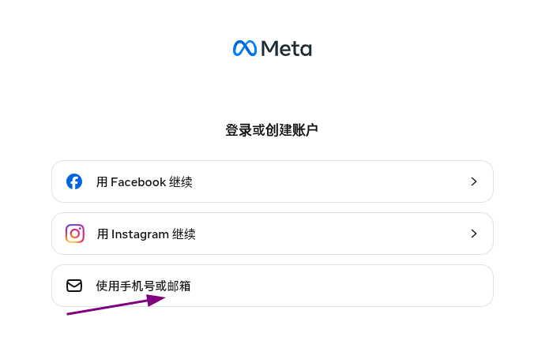
</p>

3. Fill in your personal information. Use English or Pinyin for your name (avoid Chinese characters), ensure your age is over 20, and set a login password

<p align="center">
  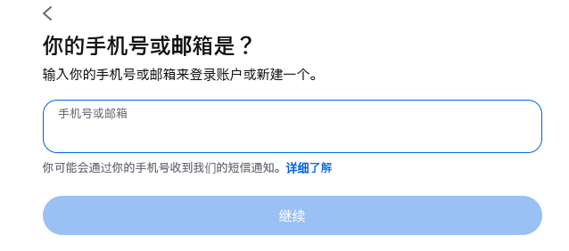
  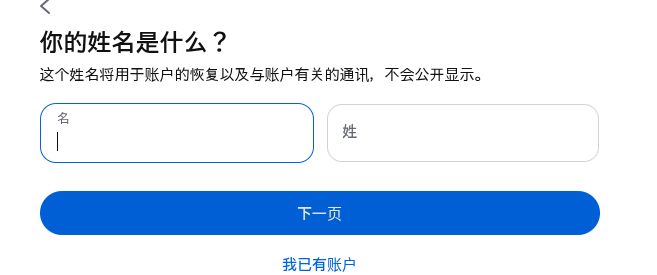
</p>

<p align="center">
  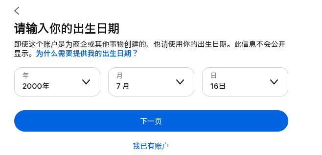
  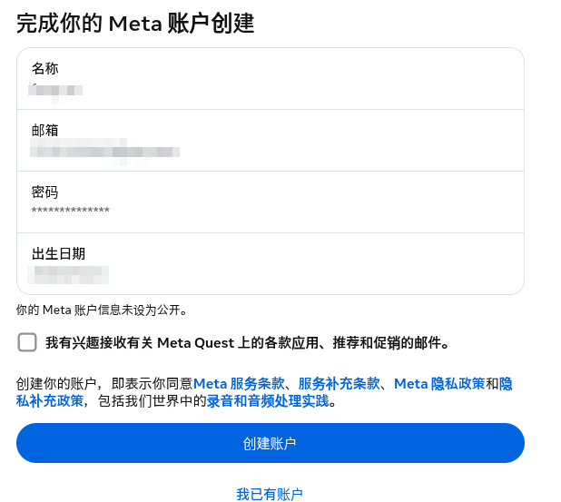
</p>

4. Enter the verification code sent to your email to complete verification
<p align="center">
  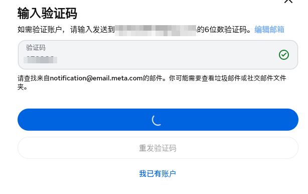
</p>

5. Set up your account username and related privacy settings (avoid using Chinese characters)
6. Complete Meta registration
7. If your account is suspended, upload a clear photo showing your facial features to lift the suspension

---

# 3. Install and Use Meta Horizon Mobile App

The **Meta Horizon** mobile app is required for activation.

| Platform | Download Method |
|----------|----------------|
| Android | Open in browser: [https://oc-static.xlemon.cn/oculus/Oculus_latest.apk](https://oc-static.xlemon.cn/oculus/Oculus_latest.apk) |
| iPhone | Download from App Store (requires a non-China region Apple ID) |

After downloading, log in to the Meta Horizon mobile app using your email account.

---

# 4. Using Oculus Helper

Oculus Helper official website: [https://ochelper.xlemon.cn/home.html](https://ochelper.xlemon.cn/home.html)

Use **Oculus Helper WiFi Edition** for activation first. If it fails, try the **Express Edition**.

After downloading and installing, run the software and ensure the following conditions are met:

1. Unplug the Ethernet cable and disconnect any wired connections, keeping only the WiFi network connection
2. Disable Windows built-in firewall and any third-party antivirus software before use
3. Open Oculus Helper and wait a few minutes for updates and network adapter configuration to complete

> Note: For issues with Oculus Helper, refer to the official documentation and tutorials.

---

# 5. Meta Quest Activation

1. Power on the headset, follow the on-screen instructions, select **Chinese (中文)** as the language, and connect to the WiFi network provided by Oculus Helper based on the version you selected
2. At the same time, connect your phone to the Oculus Helper WiFi as well
3. After the resource update is complete, you will be prompted to pair with the Meta Horizon app on your phone. Follow the on-screen instructions (note: both the headset and phone must be connected to the Oculus Helper hotspot at this point)
4. Once pairing is complete, your Meta Quest device is ready to use

> Note: The headset may occasionally disconnect from the hotspot. Monitor the connection status — reconnecting will allow downloads to resume.

---

# 6. Developer Mode

### 6.1 Identity Verification

1. Go to the developer mode verification page: [https://developer.oculus.com/manage/verify/](https://developer.oculus.com/manage/verify/)
<p align="center">
  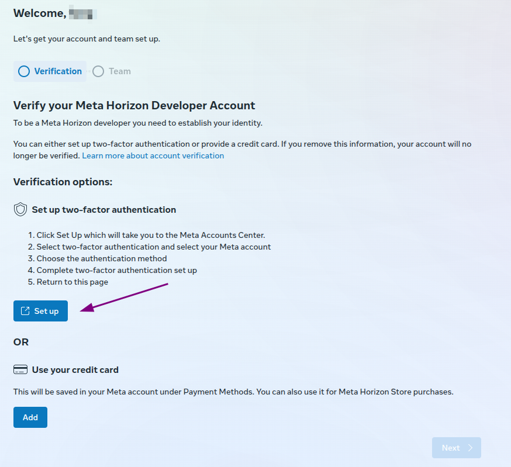
</p>

2. Click **Set Up**
3. Click two-factor authentication and select **Authenticator App**
<p align="center">
  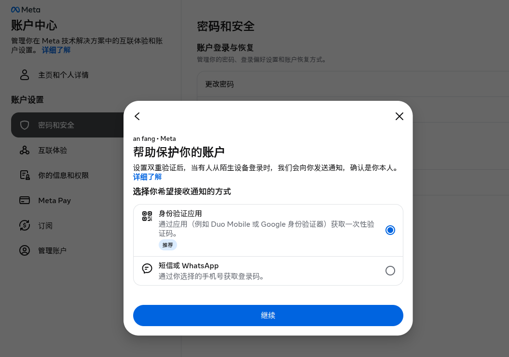
  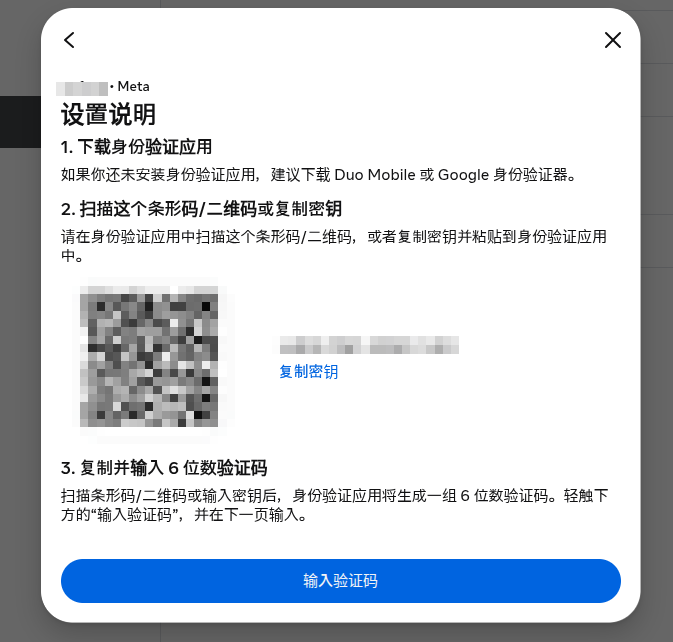
</p>

4. Download Microsoft Authenticator: [https://www.microsoft.com/zh-cn/security/mobile-authenticator-app#downloadtheapp](https://www.microsoft.com/zh-cn/security/mobile-authenticator-app#downloadtheapp)


<p align="center">
  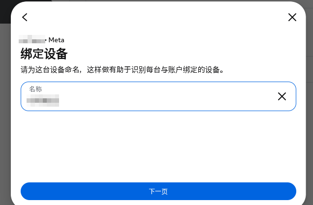
  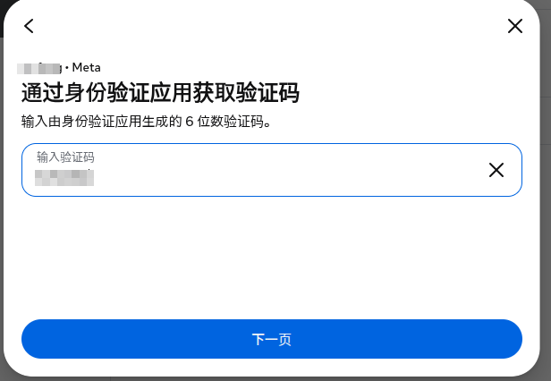
  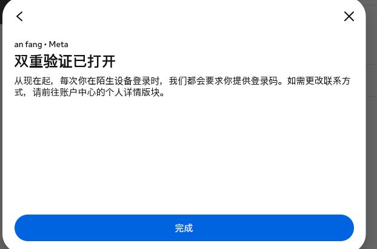
</p>

5. Sign in with your personal account, scan the QR code on the Meta website, and enter the Meta account verification code from the Microsoft Authenticator app

### 6.2 Create Organization

After verification is complete, create an organization at the following website: [https://developer.oculus.com/manage/organizations/create/](https://developer.oculus.com/manage/organizations/create/), and follow the on-screen instructions.

<p align="center">
  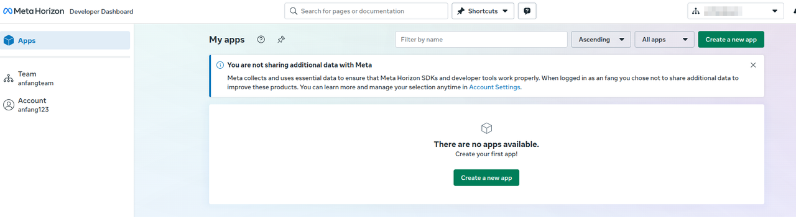
</p>

### 6.3 Enable Developer Mode

Once successful, you can enable it in the Meta app:

```
Devices → Device Settings → Advanced Settings → Developer Mode → Toggle On
```

<p align="center">
  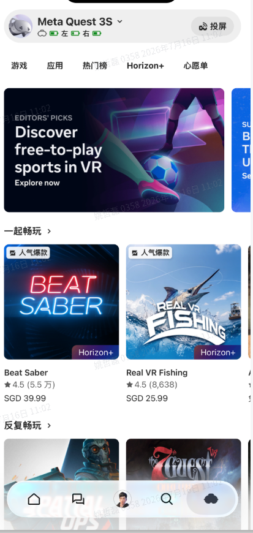
  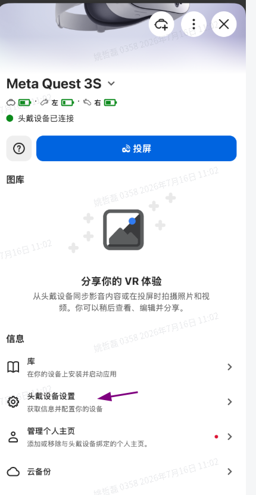
  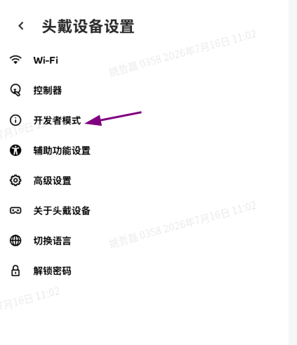
  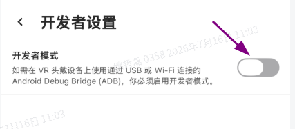
</p>


# 7. Notes

- This guide is based on Meta Quest 3s. Other versions may require adjustments based on actual conditions.
- This guide is intended to provide a simple workflow for Meta Quest registration and setup for user reference.

# 8. Acknowledgments

- [oculus-helper](https://www.yuque.com/oculus-helper)
- [jayy/Quest-help](https://www.yuque.com/jayy/30)